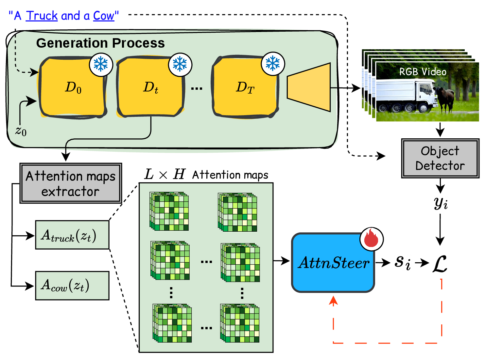

# Will It Render? Learned Attention Steering for Object Presence in Text-to-Video

Ben Fishman¹ · Dvir Samuel² · Gal Chechik¹² · Idan Schwartz¹ — ¹Bar-Ilan University, ²NVIDIA

**[Project page](https://benf22.github.io/will-it-render/)** · Paper (coming soon)

> **TL;DR** — **The problem:** not all requested objects are rendered by text-to-video models.
> **Our solution:** train a tiny model (37k parameters) on the generator's attention maps that
> predicts whether each requested object will render; then use it as a differentiable steering
> signal at inference time — no model retraining, no hand-crafted objectives needed.

We call the tiny model **AttnSteer**. Backends: **LTX-2**, **WAN (Wan2.1)**, **CogVideoX**.

### How it works

**Training** — one AttnSteer model per denoising step, on cross-attention maps toward each word:



**Inference** — backpropagate the AttnSteer loss into the latent to make the object render:


> **Status: migrated, GPU-validated, pre-release.** The full module tree (common / backends /
> inference / datasets / training / evaluation + baselines), configs, packaging, docs, tests,
> and CI are in place; the whole package imports cleanly and the CPU suite is green.
> **All three backends run end-to-end on GPU with real trained AttnSteer weights** (WAN on L40S;
> LTX + CogVideoX on H100), and the migrated code is **bit-identical** to the original research
> code on a matched prompt/seed. Probe weights / bundles are not yet uploaded.

## Why "will it render"

An AttnSteer model reads one denoising step's cross-attention toward the target word and
predicts the probability the object will be present in the final video — *will it render?*
At inference we backpropagate that model's loss into the current-step latent to make the
answer yes (induce the object) or no (suppress it).

## Install

```bash
pip install -e .                 # core (AttnSteer + feature I/O + configs)
pip install -e ".[all]"          # + detectors, audio, baselines, vbench (heavy)
```

The DiT engines are **not** pip dependencies — point the package at your local checkouts:

```bash
export VP_LTX_ROOT=/path/to/LTX-2
export VP_WAN_ROOT=/path/to/Wan2.1
export VP_COGX_ROOT=/path/to/CogVideoX     # or rely on pip `diffusers` for CogVideoX
```

Pinned upstream commits are documented per backend in `src/will_it_render/backends/README.md`.

## Quick start (planned)

```bash
# one prompt + one AttnSteer bundle (checkpoint + extraction config + seed latent) → steered video
wir-run --backend wan --bundle <hf-bundle-or-path> --prompt "a dog on a beach" --seed 42
```

See `src/will_it_render/inference/README.md` for the bundle contract and determinism notes.

## Layout

| Path | Purpose |
|------|---------|
| `src/will_it_render/common/` | dependency-sink: AttnSteer factory, feature aggregation, prompt/config helpers, env-var path resolver |
| `src/will_it_render/backends/` | DiT backend adapters + attention-capture hooks (LTX / WAN / CogVideoX) + seed latents |
| `src/will_it_render/inference/` | steering optimization loop + `run.py` entry point |
| `src/will_it_render/datasets/` | prompt generation, feature extraction, labeling |
| `src/will_it_render/training/` | AttnSteer architectures + trainer + AUROC/AP/F1 evaluation |
| `src/will_it_render/evaluation/` | det-all / det-ratio / VBench / runtime metrics + baselines |
| `configs/` · `scripts/` · `examples/` · `tests/` | sanitized configs, thin CLIs, demo data, test suite |

Each `src/will_it_render/*` subpackage is **standalone** (imports only `common/` and
`backends/`, never a sibling) and carries its own README.

## License

MIT (see `LICENSE`). Third-party components under other licenses (Apache-2.0, AGPL, model
community licenses) are listed in `THIRD_PARTY.md`.
