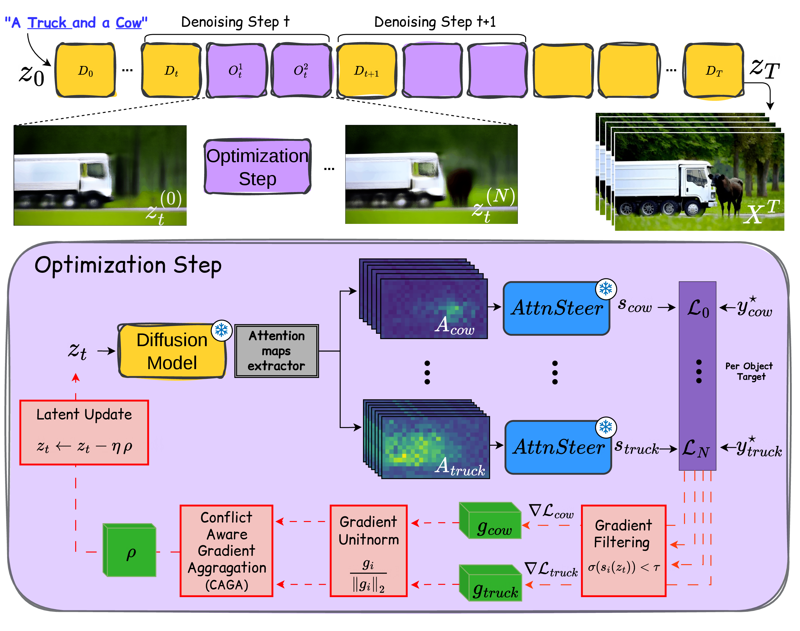

# Will It Render? Learned Attention Steering for Object Presence in Text-to-Video

Ben Fishman¹ · Dvir Samuel² · Gal Chechik¹² · Idan Schwartz¹ — ¹Bar-Ilan University, ²NVIDIA

**[Project page](https://benf22.github.io/will-it-render/)** · **[Models 🤗](https://huggingface.co/benf22/will-it-render)** · Paper (coming soon)

> **TL;DR** — **The problem:** not all requested objects are rendered by text-to-video models.
> **Our solution:** train a tiny model (37k parameters) on the generator's attention maps that
> predicts whether each requested object will render; then use it as a differentiable steering
> signal at inference time — no model retraining, no hand-crafted objectives needed.

We call the tiny model **AttnSteer**. Backends: **LTX-2**, **WAN (Wan2.1)**, **CogVideoX**.

### How it works

**Training** — one AttnSteer model per denoising step, on cross-attention maps toward each word:


**Inference** — backpropagate the AttnSteer loss into the latent to make the object render:



## How can I use this repo?

Four independent uses — each is standalone with its own README, entry point, and examples:

1. **Run inference** — steer generation with our final algorithm so requested objects render.
   → [`inference/`](src/will_it_render/inference/README.md) + [`configs/steering/`](configs/steering/README.md)
2. **Train your own AttnSteer** — extract a backbone's cross-attention features and train a
   steering model, then steer with it.
   → [`datasets/`](src/will_it_render/datasets/README.md) + [`training/`](src/will_it_render/training/README.md)
3. **Use our dataset** — the 473-prompt WIR test set (+ generation seeds) and the auxiliary benchmarks.
   → [`data/`](data/README.md)
4. **Use our evaluation** — det-all / det-ratio object-presence metrics on **any** model's videos.
   → [`evaluation/`](src/will_it_render/evaluation/README.md)

## Why "will it render"

An AttnSteer model reads one denoising step's cross-attention toward the target word and
predicts the probability the object will be present in the final video — *will it render?*
At inference we backpropagate that model's loss into the current-step latent to make the
answer yes (induce the object) or no (suppress it).

## Install

We develop against **Python 3.10–3.12**. Generation needs a CUDA build of torch, so (for the
LTX-2 / WAN backbones) install **torch 2.9.1 cu128** from the PyTorch index *before* the package:

```bash
python -m venv .venv && source .venv/bin/activate          # or: uv venv --python 3.12 .venv
pip install torch==2.9.1 --index-url https://download.pytorch.org/whl/cu128
pip install -e .            # core (AttnSteer + feature I/O + configs)
pip install -e ".[all]"     # + detectors, baselines, vbench (heavy, optional)
pip install -e ".[dev]"     # + pytest/ruff, to run the test suite
```

CPU-only use (tests, feature I/O — no video generation) works with just `pip install -e ".[dev]"`
and any torch ≥ 2.4. CogVideoX wants a different stack (torch 2.11); use a separate venv for it.

### DiT engines (external — not pip deps)

The backbones are local checkouts resolved via env vars (we ship only our hooks, not the
engines). Check out the **exact commits we used**:

| Backbone | How to get it | Versions | Env var |
|----------|---------------|----------|---------|
| **LTX-2** | `git clone https://github.com/Lightricks/LTX-2 && git -C LTX-2 checkout 1799988` | torch 2.9.1 (cu128) | `export VP_LTX_ROOT=$PWD/LTX-2` |
| **WAN (Wan2.1)** | `git clone https://github.com/Wan-Video/Wan2.1 && git -C Wan2.1 checkout 7c81b2f` | torch 2.9.1, diffusers 0.39 | `export VP_WAN_ROOT=$PWD/Wan2.1` |
| **CogVideoX-5B** | `pip install "diffusers==0.39"` (no clone needed) | transformers 5.x, torch 2.11 | `VP_COGX_ROOT` optional |

Each engine also needs its own runtime deps. WAN's `requirements.txt` lists `flash_attn`, but
Wan2.1 runs on its built-in **SDPA** attention path without it; the minimal set is:
`pip install "diffusers==0.39" transformers accelerate imageio imageio-ffmpeg einops ftfy opencv-python-headless "numpy<2"`.

Model weights (point `configs/models/<backbone>.yaml` at your paths): LTX
`ltx-2.3-22b-distilled-1.1` + the Gemma-3-12B text encoder; `Wan-AI/Wan2.1-T2V-1.3B`;
`THUDM/CogVideoX-5b` (auto-downloaded by diffusers).

## Quick start

```bash
export VP_WAN_ROOT=/path/to/Wan2.1
# fetch a trained AttnSteer bundle (checkpoints + extraction_config + seed latents) from HF…
bundle=$(python -m scripts.download_artifacts --repo benf22/will-it-render --bundle wan --quiet)
# …then steer the requested objects so they render (WAN drops the kite; AttnSteer brings it back):
wir-run --bundle "$bundle" --prompt "a kite and a baseball bat" \
    --target-words "kite,baseball bat" --seed 1892721232
```

**Choosing what to steer** — `--target-words` is a comma-separated list of word(s) from the prompt
to induce (e.g. `--target-words "kite"` for just the kite, or `"kite,baseball bat"` for both).
Multi-word objects are fine. Omit the flag to steer every noun in the prompt. (The config/CSV path
uses a `target_words` column instead; see [`inference/`](src/will_it_render/inference/README.md).)

These are project-page carousel prompts at their original seeds. The demo bundle ships the
latent for seed 42; for other seeds the backend samples noise on the fly — the steering still
works on any GPU, but bit-exact reproduction of the paper clip needs that seed's precomputed
latent run on its tagged GPU type (see the [reproducibility
notes](src/will_it_render/inference/README.md#reproducibility-seeds-gpus-and-determinism)).
Known-good carousel prompts on the other backbones:

```bash
# LTX-2 (rescues cow + dog + boat)
ltx=$(python -m scripts.download_artifacts --repo benf22/will-it-render --bundle ltx --quiet)
wir-run --bundle "$ltx" --prompt "a tie and a cow and a dog and a boat" \
    --target-words "cow,dog,boat" --seed 1547425198          # needs VP_LTX_ROOT

# CogVideoX (rescues the refrigerator)
cogx=$(python -m scripts.download_artifacts --repo benf22/will-it-render --bundle cogvideox --quiet)
wir-run --bundle "$cogx" --prompt "a refrigerator and an elephant and a kite" \
    --target-words "refrigerator,elephant,kite" --seed 1356492204
```

See [`inference/`](src/will_it_render/inference/README.md) for the bundle contract and
determinism notes, and [How can I use this repo?](#how-can-i-use-this-repo) above for the other
three uses (train, dataset, evaluate).

## Layout

| Path | Purpose |
|------|---------|
| `src/will_it_render/common/` | dependency-sink: AttnSteer factory, feature aggregation, prompt/config helpers, env-var path resolver |
| `src/will_it_render/backends/` | DiT backend adapters + attention-capture hooks (LTX / WAN / CogVideoX) + seed latents |
| `src/will_it_render/inference/` | steering optimization loop + `run.py` entry point |
| `src/will_it_render/datasets/` | prompt generation, feature extraction, labeling |
| `src/will_it_render/training/` | AttnSteer architectures + trainer + AUROC/AP/F1 evaluation |
| `src/will_it_render/evaluation/` | det-all / det-ratio / VBench / runtime metrics + baselines |
| `configs/` · `scripts/` · `examples/` · `tests/` | sanitized configs, thin CLIs, demo data, test suite |

Each `src/will_it_render/*` subpackage is **standalone** (imports only `common/` and
`backends/`, never a sibling) and carries its own README.

## License

MIT (see `LICENSE`). Third-party components under other licenses (Apache-2.0, AGPL, model
community licenses) are listed in `THIRD_PARTY.md`.
